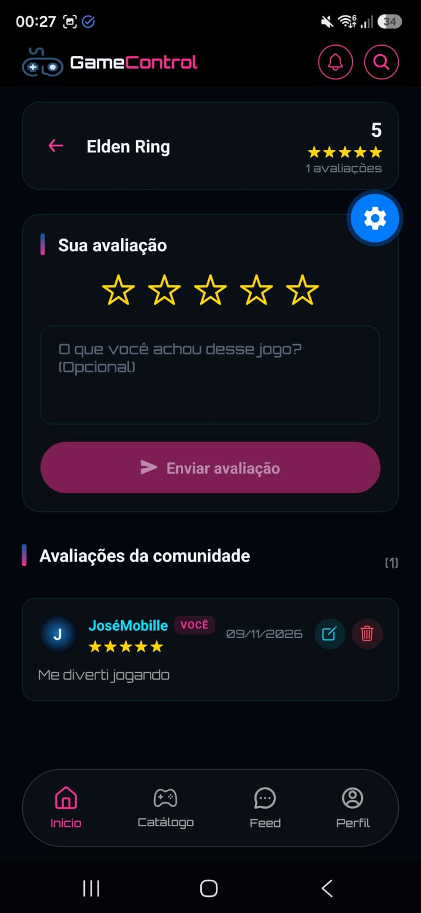
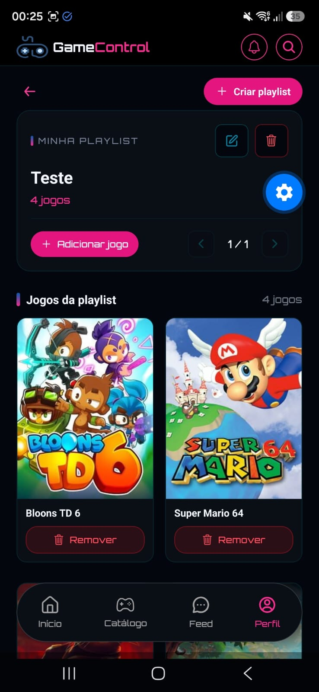
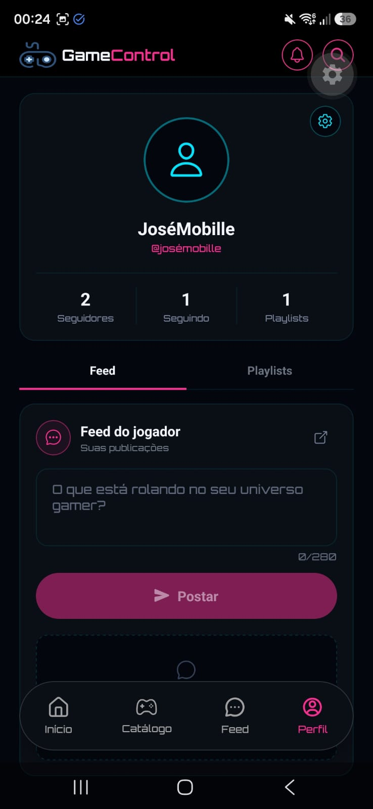

  

<strong>GameControl Mobile</strong>

Um projeto acadêmico de uma rede social voltada para gamers, inspirada nas plataformas de resenha de filmes como IMDb e Letterboxd. No GameControl, o jogador registra o que achou dos jogos que já passaram pelas suas mãos, organiza seus títulos em coleções próprias e compartilha o que está jogando com a comunidade. 

Este repositório contém o aplicativo mobile, desenvolvido em React Native com Expo.

<strong>Funcionalidades principais</strong>  

Criação de resenhas

Cada jogo do catálogo tem uma página com a nota média da comunidade e a lista de resenhas dos jogadores. O usuário pode avaliar o jogo com uma nota e um comentário, além de editar ou excluir a própria resenha quando quiser.

 

Catálogos personalizados

Além do catálogo geral de jogos, com busca e paginação, cada usuário monta suas próprias playlists: cria, edita e exclui coleções e escolhe quais jogos entram em cada uma. As playlists de outros jogadores podem ser consultadas em modo somente leitura.

 

Posts

Um feed onde os jogadores publicam textos curtos (até 280 caracteres), comentam nas publicações uns dos outros e acompanham o que as pessoas que seguem estão compartilhando. Os perfis podem ser seguidos, e contas privadas exigem a aprovação de uma solicitação de seguir.

 

<strong>Tecnologias utilizadas</strong>

<table align="center">
  <tr>
    <th>Categoria</th>
    <th>Tecnologias</th>
  </tr>
  <tr>
    <td><strong>Framework</strong></td>
    <td>
      
      
      React Native 0.86, React 19, Expo SDK 57
    </td>
  </tr>
  <tr>
    <td><strong>Linguagem</strong></td>
    <td>
      
      TypeScript
    </td>
  </tr>
  <tr>
    <td><strong>Navegação</strong></td>
    <td>
      
      Expo Router, React Navigation
    </td>
  </tr>
  <tr>
    <td><strong>Dados e cache</strong></td>
    <td>
      
      TanStack Query, AsyncStorage
    </td>
  </tr>
  <tr>
    <td><strong>Autenticação</strong></td>
    <td>
      
      Firebase Authentication
    </td>
  </tr>
  <tr>
    <td><strong>Notificações</strong></td>
    <td>
      
      Expo Notifications
    </td>
  </tr>
  <tr>
    <td><strong>Interface e animações</strong></td>
    <td>
      
      
      React Native Reanimated, Expo Linear Gradient, React Native SVG, Expo Image
    </td>
  </tr>
  <tr>
    <td><strong>Tipografia</strong></td>
    <td>
      
      Orbitron (Expo Google Fonts)
    </td>
  </tr>
  <tr>
    <td><strong>Testes</strong></td>
    <td>
      
      Jest, jest-expo, React Native Testing Library
    </td>
  </tr>
</table>

Equipe

[Pedro Vieira](https://github.com/CviPedro)  
[Iago Teles](https://github.com/iagooteles)  
[Jose Matheus](https://github.com/Jose-Matheus748)  
[Cauet Rodrigues](https://github.com/Cauettt)  
[Simon Souza](https://github.com/SimonSousa25) 